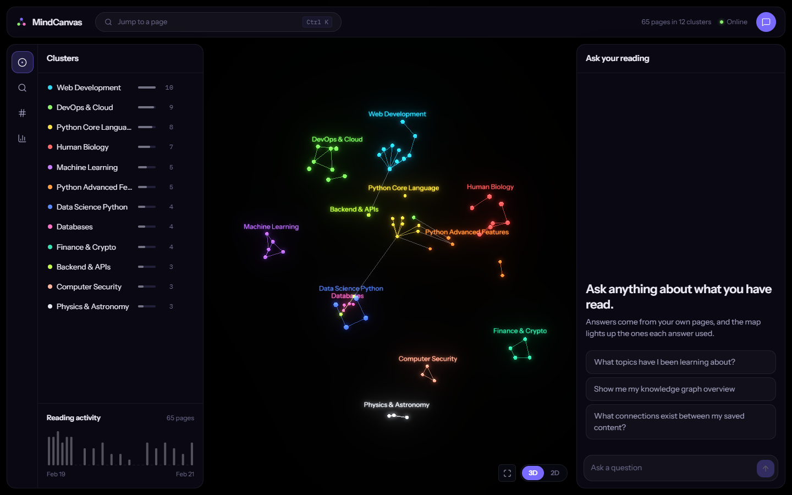
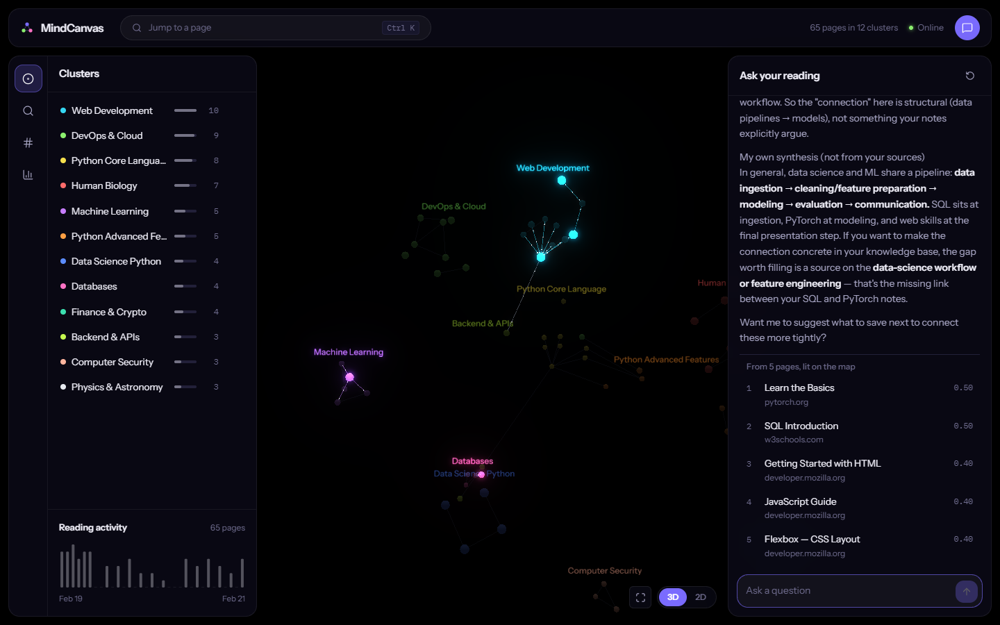
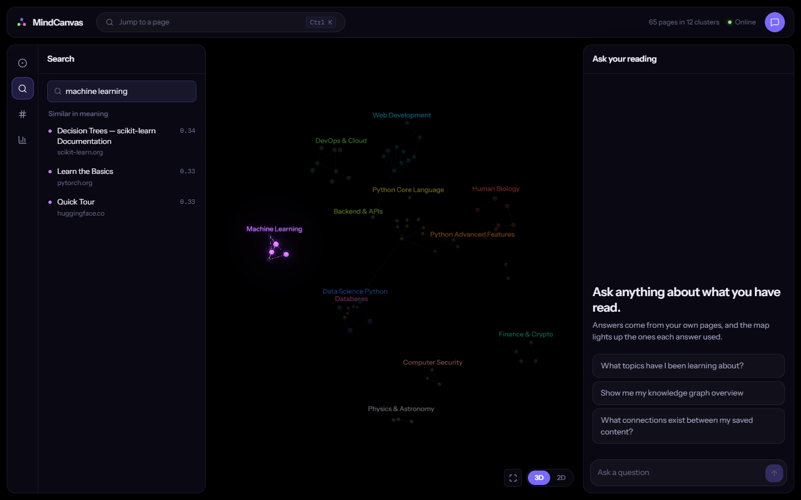
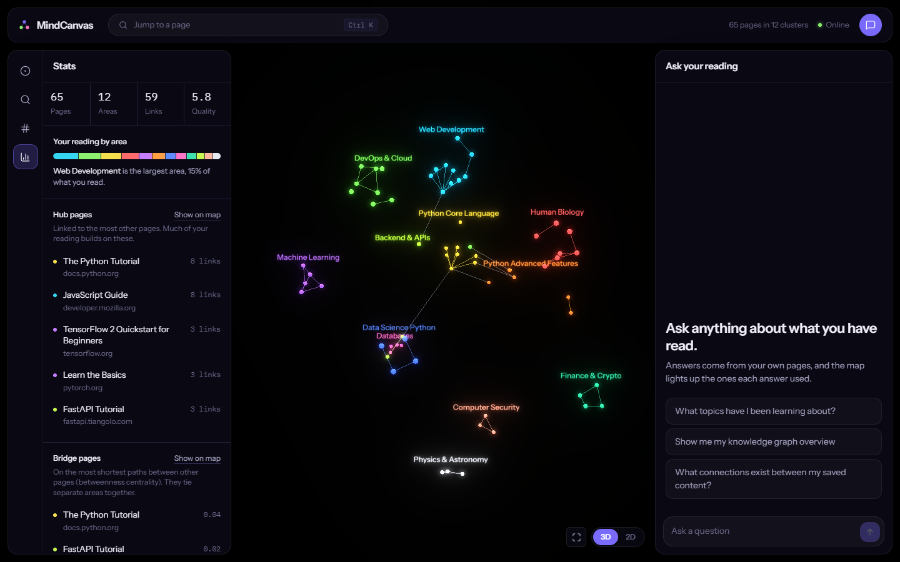
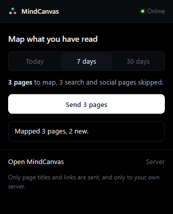

# MindCanvas

MindCanvas turns what you read on the web into a 3D knowledge map you can ask questions of. Every page you read becomes a node, related pages cluster into areas, and when you ask a question the answer cites your own pages and the map lights up the ones it used.



The first version is published as a first-author paper: [An AI System for Transforming Scattered Web Data into an Interactive, Queryable Knowledge Graph](https://ijesr.org/index.php/ijesr/article/view/1635), International Journal of Engineering & Science Research, Vol. 16, Issue 2, April 2026.

## What it does

- **Maps your reading.** A Chrome extension sends the pages you visited. The backend reads each page, summarises it, embeds it and groups it with related pages.
- **Shows it in 3D.** Each cluster glows in its own colour, like neurons in a [Brainbow](https://en.wikipedia.org/wiki/Brainbow) image, with links between closely related pages. A 2D view is one click away for reading titles.
- **Answers questions from your pages.** Retrieval-augmented chat answers with numbered citations. The camera turns to the cited pages and lights them up, so you can see where every answer came from.
- **Finds by meaning.** Search matches titles instantly and pages with the same meaning through vector search, so "learning from data with neural networks" finds the PyTorch and TensorFlow pages. Every match lights up on the map as you type.
- **Analyses the graph.** Stats show what share of your reading each area takes, the hub pages with the most links, the bridge pages that join separate areas (betweenness centrality, Brandes' algorithm) and which areas connect most.
- **Shows when you read.** A small activity chart under the clusters shows when each page was read; hovering a stretch of time lights those pages on the map.
- **Works without an LLM.** With no API key, clusters, names and links come from the embeddings alone (see [How it works](#how-it-works)).



| Search by meaning | Graph analysis |
| --- | --- |
|  |  |

## How it works

```
Chrome extension ──► POST /api/ingest ──► FastAPI backend ──► PostgreSQL + pgvector
                                            │
                                            ├─ fetch and clean each page (BeautifulSoup)
                                            ├─ summary, topics, type (LLM, batched JSON)
                                            └─ 384-dim embedding (all-MiniLM-L6-v2, local)

React app ──► GET /api/knowledge-graph/export ──► clusters + links
          └─► POST /api/chat ──► vector search over your pages ──► answer with cited sources
```

**Clustering.** With an LLM available, one call assigns every page to a cluster and proposes links. LLMs do not follow cluster counts reliably, so any cluster under three pages is folded into the cluster whose centroid is closest in embedding space.

**Without an LLM.** Pages are clustered with Ward agglomerative clustering on the normalised embeddings. Each cluster is named with class-based TF-IDF (the idea behind BERTopic): the terms most frequent inside the cluster and rarest in the others. Each page links to its nearest neighbours above a similarity floor, which keeps the graph sparse and every link meaningful. See [`backend/semantic_graph.py`](backend/semantic_graph.py).

**Chat.** The question is embedded, the closest pages are retrieved from pgvector, and the model answers only from them, citing each claim as `[n]`. Sources come back with their node ids, which is how the map knows what to light up.

## Tech stack

| Layer | Technology |
| --- | --- |
| Frontend | React 19, TypeScript, Vite, Tailwind CSS 4, three.js with react-force-graph, Zustand, Motion |
| Backend | Python 3.13, FastAPI, asyncpg, LangChain, OpenAI SDK, scikit-learn, sentence-transformers |
| Data | PostgreSQL 16 with pgvector |
| LLM | Any OpenAI-compatible API: OpenAI, DeepSeek and others |
| Extension | Chrome Manifest V3 |
| Infrastructure | Docker Compose, nginx for the production build |

## Quick start

You need Docker and an API key for an OpenAI-compatible LLM. The key is optional: without one, the map still works and only chat is unavailable.

```bash
git clone https://github.com/Sa1f27/MindCanvas.git
cd MindCanvas
cp backend/.env.example backend/.env   # then add your key
docker compose up -d --build
```

Open http://localhost:3030. The API runs on http://localhost:8090, with interactive docs at http://localhost:8090/docs.

To try it without your own history, load the 65 sample pages:

```bash
curl -X POST http://localhost:8090/api/ingest -H "Content-Type: application/json" -d @sample/sample_data.json
# Windows PowerShell: .\sample\load_sample_data.ps1
```

### Choosing the LLM

Set these in `backend/.env`. Every LLM call (page analysis, clustering and chat) uses the same model.

```env
# OpenAI
OPENAI_API_KEY=sk-...
OPENAI_MODEL=gpt-6-luna

# Or any OpenAI-compatible provider, e.g. DeepSeek
OPENAI_API_KEY=sk-...
OPENAI_BASE_URL=https://api.deepseek.com
OPENAI_MODEL=deepseek-chat
```

Embeddings always run locally, so they cost nothing.

### Chrome extension



1. Open `chrome://extensions` and turn on **Developer mode**.
2. Click **Load unpacked** and choose the `extension/` folder.
3. Open the MindCanvas popup, pick a range (today, 7 days or 30 days) and send.

Search results, social feeds, logins and media files are skipped. Only page titles and links are sent, and only to your own server. To use a server elsewhere, for example through a Cloudflare tunnel, change the address under **Server** in the popup.

<br clear="right" />

## API

| Method | Endpoint | Description |
| --- | --- | --- |
| `POST` | `/api/ingest` | Add pages: a list of `{url, title}` |
| `GET` | `/api/knowledge-graph/export` | Nodes, links and clusters for the map |
| `POST` | `/api/chat` | Ask a question; returns the answer and its sources |
| `POST` | `/api/search/semantic` | Vector search by meaning |
| `GET` | `/api/related/{id}` | Pages closest in meaning to one page |
| `GET` | `/api/trending` | Most frequent topics |
| `GET` | `/api/stats` | Totals by content type |
| `GET` | `/api/health` | Health check |

## Project structure

```
backend/
  main.py             API, page processing and graph export
  semantic_graph.py   clustering, naming and links from embeddings
  database.py         PostgreSQL + pgvector access
  rag_chatbot.py      retrieval and answers with citations
frontend/src/
  components/graph/   3D and 2D map, layout forces, highlighting
  components/ask/     chat panel and citations
  components/rail/    clusters, search, topics, stats
  store/              graph, chat and UI state (Zustand)
  lib/                typed API client, graph analysis (with tests), palette
extension/            Chrome extension (Manifest V3)
sample/               65 sample pages to try it with
```

## Development

```bash
# Backend (needs PostgreSQL with pgvector; DATABASE_URL in backend/.env)
cd backend && pip install -r requirements.txt && uvicorn main:app --reload --port 8090

# Frontend
cd frontend && npm install && npm run dev   # also: npm test, npm run typecheck, npm run lint, npm run build
```

## Citation

```bibtex
@article{huzaifah2026mindcanvas,
  title   = {An AI System for Transforming Scattered Web Data
             into an Interactive, Queryable Knowledge Graph},
  author  = {Huzaifah, Mohammed and Mujeeb, Syed Abdul Muqeet
             and Mohammed, Niyazuddin and Ali, Mir Danish},
  journal = {International Journal of Engineering \& Science Research},
  volume  = {16},
  number  = {2},
  pages   = {338--347},
  year    = {2026}
}
```

## License

MIT. See [LICENSE](LICENSE).
